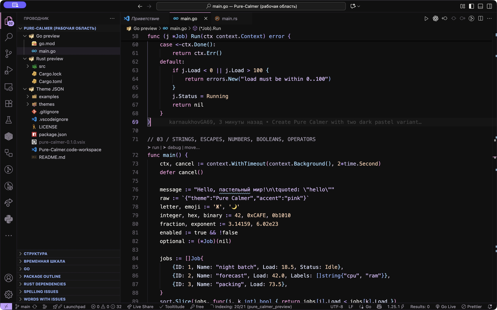
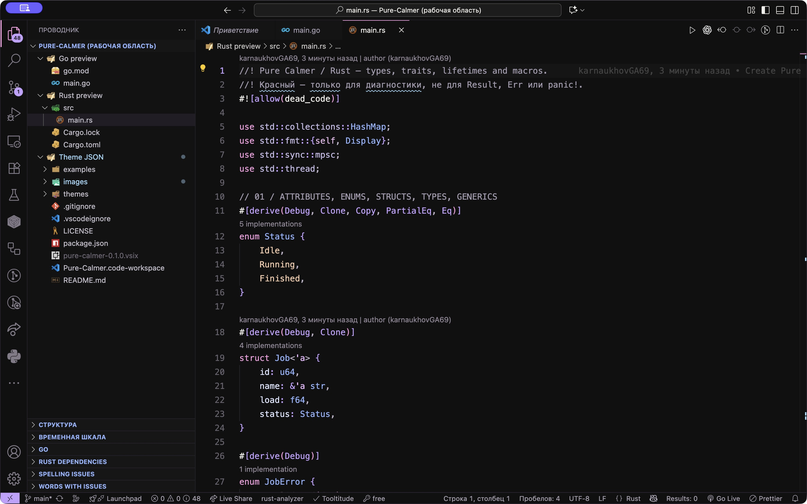

# Pure Calmer

Nearly black backgrounds. Calm pastel colors. A little more room to breathe.

A personal VS Code theme built around pink keywords, blue types, sky-blue functions and lavender strings. No mint or turquoise syntax accents; red is reserved for errors and invalid code.

## Two variants

- **Pure Calmer** — brighter text and stronger color separation.
- **Pure Calmer Original** — the softer, more muted first palette.

Both keep the same `#101010` editor background and include TextMate and semantic token colors, workbench styling, terminal colors and diff colors.

## Screenshots

### Go



### Rust



Screenshots show the brighter Pure Calmer variant in VS Code. File icons and language extension annotations are separate from the color theme.

## Install

1. Download `pure-calmer-0.1.0.vsix` from [Releases](https://github.com/karnaukhovGA69/pure-calmer/releases/latest).
2. In VS Code, run **Extensions: Install from VSIX…** and choose the file.
3. Run **Preferences: Color Theme** (`Cmd+K Cmd+T` on macOS, `Ctrl+K Ctrl+T` on Windows/Linux).
4. Select **Pure Calmer** or **Pure Calmer Original**.

This project is distributed on GitHub only. It is not published to the VS Code Marketplace.

## Preview the syntax

Open `Pure-Calmer.code-workspace`. The `examples` folder contains standalone Go and Rust projects covering types, generics, interfaces/traits, methods, macros, strings, literals, closures and concurrency. Intentional type errors are commented out; uncomment them to inspect error diagnostics.

```sh
go -C examples/go test ./...
cargo check --manifest-path examples/rust/Cargo.toml
```

Go and Rust language extensions provide richer semantic highlighting. Other extensions and user color overrides may change the final appearance. File icon themes are separate from this color theme.

## Palette

| Role | Pure Calmer | Original |
| --- | --- | --- |
| Background | `#101010` | `#101010` |
| Foreground | `#F2EFEB` | `#E6E2DD` |
| Keywords | `#F49CDE` | `#E8B4D9` |
| Types | `#91B4FF` | `#A9BFFF` |
| Functions | `#A5DDFF` | `#B9DDFC` |
| Strings | `#DEC0FF` | `#D8C7F1` |
| Errors | `#F07888` | `#F07888` |

## Development

Edit the JSON files in `themes/`. Package a local build with:

```sh
npx @vscode/vsce package
```

The theme is declarative JSON: it has no executable extension entrypoint, dependencies or telemetry.

## Inspiration and license

Inspired by the nearly black background of Vesper and the pastel feel of Poimandres. Theme JSON was authored for this project; no source code from those themes is included.

MIT © 2026 karnaukhovGA69
